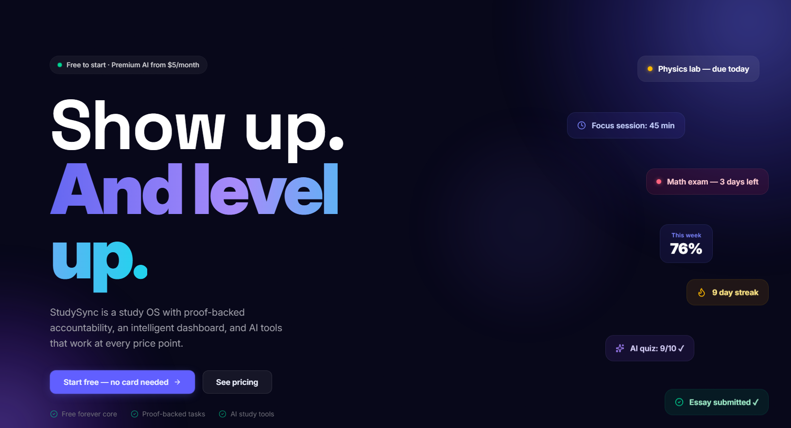

# StudySync

**Show up. And level up.**

StudySync is a study platform for students who want clear deadlines, real accountability, and AI study tools worth paying for. You add tasks when you plan them, then submit proof when you finish them.

Live: [https://studysync-pearl.vercel.app](https://studysync-pearl.vercel.app)



## Plans

| Plan    | Price     | AI credits / month | Proof method                 | AI model        |
| ------- | --------- | ------------------ | ---------------------------- | --------------- |
| Free    | $0        | 0                  | Public Google Doc link       | —               |
| Premium | $5 / mo   | 60                 | Image upload                 | `gpt-4.1-mini`  |
| Power   | $20 / mo  | 240                | Image upload                 | `gpt-4.1`       |

AI usage is limited per plan, both monthly and per minute, and enforced on the server.

## Features

### Tasks and accountability
- Create, edit, and delete tasks, with quick-start templates
- Proof is submitted **when a task is completed**, not when it's created
- Free users submit proof with a public Google Doc; Premium and Power users upload an image (stored in Firebase Storage)
- Server-side proof verification (`/api/tasks/verify-proof`)
- Dashboard: due today, overdue, upcoming, completion rate, streaks, filters, sorting, and a weekly view

### AI study tools (Premium / Power)
- Study Planner
- Quiz Generator (interactive)
- Flashcard Generator
- Topic Explainer
- Study Breakdown

### Account and billing
- Email/password auth with Firebase Authentication
- Stripe Checkout for Premium and Power, plus the Stripe Customer Portal for managing subscriptions
- Billing status endpoint, kept in sync by Stripe webhooks
- **Delete account** (server-side, `/api/account/delete`): cancels any Stripe subscription, deletes proof images from Storage, recursively deletes the user document and all subcollections (tasks, AI history), then deletes the Firebase Auth user

### Design and mobile
- Dark, borderless "flowy" interface with an indigo brand palette
- Mobile bottom navigation on small screens and bottom-sheet modals
- Safe-area support for notched phones (`viewport-fit=cover`, `env(safe-area-inset-bottom)`)
- Installable PWA manifest (`display: standalone`)
- Public pages: landing, pricing, support, plus Terms, Privacy, Refund, and Cookie policies

### Privacy, legal, and accessibility
- Full Terms of Service, Privacy Policy (GDPR/CCPA rights, subprocessors, retention, children), Refund Policy, and Cookie Policy (`/terms`, `/privacy`, `/refunds`, `/cookies`)
- Signup requires an age confirmation (13+, parental permission under 18) and Terms/Privacy acceptance. The consent version and timestamp are stored on the user document as `consent`
- Cookie notice. The app uses only strictly necessary storage: no analytics, ads, or trackers
- Auto-renewal disclosure next to the subscribe buttons
- Data minimization: AI requests don't include the user's email, and OpenAI calls use `store: false`
- Fonts are self-hosted (`@fontsource`, SIL OFL), so pages make no third-party requests
- No fabricated stats, reviews, or "most popular" claims in marketing copy
- WCAG-minded: AA text contrast, visible keyboard focus, skip link, landmarks, `aria-pressed` and `aria-expanded` states, reduced-motion support
- No marketing emails are sent. Only Firebase password resets and Stripe receipts. If opt-in emails are ever added, each one must include an unsubscribe link

## Tech stack

- **Frontend:** React 19, Vite 8, React Router 7, Tailwind CSS 4, lucide-react, motion
- **Auth / data / files:** Firebase Authentication, Firestore, Firebase Storage
- **Backend:** Vercel serverless functions (`api/`)
- **Billing:** Stripe Checkout, Customer Portal, Webhooks
- **AI:** OpenAI

## Project structure

```text
studysync/
├─ api/
│  ├─ _lib/                         # auth, firebaseAdmin, openai, stripe, subscriptions
│  ├─ account/delete.js
│  ├─ ai/generate.js
│  ├─ billing/
│  │  ├─ create-checkout-session.js
│  │  ├─ create-portal-session.js
│  │  ├─ status.js
│  │  └─ webhook.js
│  └─ tasks/verify-proof.js
├─ docs/
│  ├─ architecture.md
│  └─ firestore-schema.md
├─ public/manifest.json
├─ src/
│  ├─ app/AppRoot.jsx               # routes
│  ├─ components/                   # ui.jsx (design system), layout.jsx, brand.jsx
│  ├─ contexts/                     # AuthContext
│  ├─ firebase/
│  ├─ lib/
│  ├─ pages/
│  └─ services/                     # firestore.js, storage.js, api.js
├─ firestore.rules
├─ storage.rules
├─ vercel.json
└─ .env.example
```

### Routes

| Public                                                                 | App (signed in)                                          |
| ---------------------------------------------------------------------- | -------------------------------------------------------- |
| `/`, `/pricing`, `/terms`, `/privacy`, `/refunds`, `/cookies`, `/support`, `/login`, `/signup` | `/app`, `/app/ai`, `/app/billing`, `/app/account`, `/app/settings` |

## Local setup

```bash
npm install
cp .env.example .env      # then fill in values
npm run dev               # frontend only
npx vercel dev            # frontend + serverless API routes
```

Other scripts: `npm run build`, `npm run lint`, `npm run preview`.

## Environment variables

Client:

```env
VITE_FIREBASE_API_KEY=
VITE_FIREBASE_AUTH_DOMAIN=
VITE_FIREBASE_PROJECT_ID=
VITE_FIREBASE_STORAGE_BUCKET=
VITE_FIREBASE_MESSAGING_SENDER_ID=
VITE_FIREBASE_APP_ID=
VITE_API_BASE_URL=
```

Server:

```env
APP_URL=http://localhost:3000
# Optional. Falls back to VITE_FIREBASE_STORAGE_BUCKET (used by account deletion)
FIREBASE_STORAGE_BUCKET=

FIREBASE_ADMIN_PROJECT_ID=
FIREBASE_ADMIN_CLIENT_EMAIL=
FIREBASE_ADMIN_PRIVATE_KEY=

STRIPE_SECRET_KEY=
STRIPE_WEBHOOK_SECRET=
STRIPE_PREMIUM_PRICE_ID=
STRIPE_POWER_PRICE_ID=

OPENAI_API_KEY=
OPENAI_MODEL=gpt-4.1-mini
OPENAI_POWER_MODEL=gpt-4.1
PREMIUM_AI_MONTHLY_LIMIT=60
PREMIUM_AI_PER_MINUTE_LIMIT=6
POWER_AI_MONTHLY_LIMIT=240
POWER_AI_PER_MINUTE_LIMIT=12
```

## Firebase setup

1. Create a Firebase project and a web app; copy its config into the `VITE_FIREBASE_*` vars.
2. Enable **Email/Password** authentication.
3. Create a Firestore database (production mode) and publish `firestore.rules`.
4. Enable **Firebase Storage** and publish `storage.rules` (needed for image proof uploads).
5. Create a service account (Project Settings → Service accounts) and copy `project_id`, `client_email`, and `private_key` into the `FIREBASE_ADMIN_*` vars.

## Stripe setup

1. Create two products with recurring monthly prices: **StudySync Premium** ($5) and **StudySync Power** ($20).
2. Put their price IDs in `STRIPE_PREMIUM_PRICE_ID` and `STRIPE_POWER_PRICE_ID`.
3. Enable the Customer Portal and set `STRIPE_SECRET_KEY`.
4. Add a webhook endpoint at `/api/billing/webhook` and subscribe to:
   - `checkout.session.completed`
   - `customer.subscription.created`
   - `customer.subscription.updated`
   - `customer.subscription.deleted`
5. Put the signing secret in `STRIPE_WEBHOOK_SECRET`.

## OpenAI setup

1. Set `OPENAI_API_KEY`.
2. `OPENAI_MODEL` is used for Premium and `OPENAI_POWER_MODEL` for Power.
3. Change the `*_AI_MONTHLY_LIMIT` and `*_AI_PER_MINUTE_LIMIT` values to control costs.

## Deployment (Vercel)

1. Import the repo into Vercel.
2. Add all client and server env vars to the project settings.
3. Set `APP_URL` to your production domain.
4. Point the Stripe webhook at the production `/api/billing/webhook`.
5. Redeploy.

## Changelog

### Latest
- **Launch review:** Firestore rules stop clients from creating a profile with a paid tier, fake Stripe IDs, or altered credit counters. They're tested with 23 emulator cases. The AI endpoint only forwards each tool's own fields, and a credit is refunded if generation fails. Unexpected API errors stay in the server logs instead of reaching the browser. Login errors are shown in plain English. An app-wide error screen auto-recovers after deploys. New StudySync app icons (the template Vite logo is gone), PNG and maskable icons, social share image and meta tags, and `robots.txt` and `sitemap.xml`
- **Billing:** the Stripe webhook syncs from the customer's best subscription. The Power price lives in the same Stripe account as Premium, and the portal allows switching between them
- **Proof:** uploaded images are checked by AI against the task title, course, and description
- **Compliance pass:** legal pages, signup consent and age gate, cookie notice, full server-side account deletion, removal of unsupported claims, contrast and keyboard accessibility fixes, self-hosted fonts, and SPA rewrites for every route (fixes 404s on `/cookies`)
- **Fixed:** on mobile, typing in a modal (for example, creating or editing a task) closed the keyboard after every letter. The modal re-ran its focus logic on every keystroke and moved focus to the close button. It now sets focus only when it opens.
- Redesign: borderless indigo theme, double-S clock logo, new catchphrase ("Show up. And level up.")
- Mobile bottom navigation, bottom-sheet modals, safe-area insets, PWA manifest
- Delete account flow with cascading data deletion
- Cookies policy page
- Fixed invisible text in native `<select>` dropdowns on the dark theme

## Roadmap

- Service worker for offline support and a Google Play (TWA) release
- Study session timer and deeper analytics
- Calendar syncing
- Accountability groups
- Push reminders and email digests

## Support

omarkhalafbusiness@gmail.com
